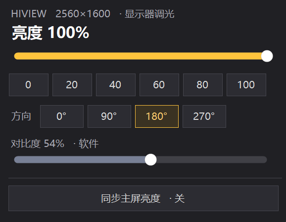

# SubBrightness · 副屏亮度

[English](#english) · 中文

Windows 托盘小工具：给**外接 / 便携显示器**调亮度、对比度、旋转方向。热键、托盘滚轮、多屏同时管，单个 exe、无需安装。



## 功能

- **自动选调光通路**，每块屏单独判断（见下文）
- 亮度 / 对比度滑块，快捷档位
- **同步主屏亮度**：笔记本内屏（Fn 键 / Windows 滑条）一变，副屏跟着变（台式机没有内屏时不显示）
- 一键旋转 0° / 90° / 180° / 270°
- 热键调节，每块被调的屏各弹一个提示框
- **托盘图标上滚滚轮**直接调亮度
- 插拔、改分辨率、锁屏、睡眠唤醒后自动重新识别、补刷
- 界面跟随系统语言：中文 / English

## 下载与运行

从 [Releases](../../releases) 下载 `SubBrightness.exe`，双击运行，图标在右下角托盘。
只依赖 Windows 10/11 自带的 .NET Framework 4.x。

> 程序没有数字签名，首次运行 SmartScreen 可能拦一下（点「更多信息 → 仍要运行」）。
> 介意的话可以按下面的方法自己从源码编译，一共就一个 `.cs` 文件。

| 操作 | 效果 |
|---|---|
| `Ctrl` + `Alt` + `PgUp` / `PgDn` | 调亮 / 调暗一档（默认 10%） |
| `Ctrl` + `Alt` + `R` | 转屏，每按一次转 90° |
| `Ctrl` + `Alt` + `B` | 开 / 关面板 |
| 左键点托盘图标 | 开 / 关面板 |
| 托盘图标上滚滚轮 | 调亮度（每格 5%） |
| 右键点托盘图标 | 设置菜单 |

热键被别的程序占用时会自动换一个候选组合（比如 `Ctrl+Shift+Alt+R`），
**实际生效的组合在右键菜单「快捷键」里能看到**。

## 调光通路

Windows 自带的亮度滑条只管笔记本内屏。外接屏这个工具按屏自动选路：

| 通路 | 原理 | 效果 |
|---|---|---|
| **硬件背光**（首选） | DDC/CI：通过视频线里的 I2C 通道给显示器发 VCP `0x10`（亮度）/ `0x12`（对比度） | 真的改背光，省电，不损失色深 |
| **显示器调光**（可选） | 显示器丢弃亮度指令、但认对比度指令时，借对比度压暗，压到底再叠软件曲线 | 比纯软件调得更暗 |
| **软件调光**（兜底） | 改显卡输出的 gamma 曲线 | 画面变暗但背光没动，最暗约为原来一半 |

### 写入校验

不少显示器对 DDC 写入**一律回「成功」却根本不执行**。所以程序每次启动会对每块屏
写一个相邻值再读回来（随即写回原值，肉眼看不出），亮度和对比度分开判定：

- 亮度认 → 硬件背光；对比度认就走硬件，不认就用软件曲线做对比度
- 亮度不认 → 软件调光，对比度也一并走软件曲线
- 判定结果只在本次运行内有效，下次启动重新探测（改过显示器 OSD 设置也能跟上）。
  想立刻重测：右键菜单「重新检测显示器」

### 「借对比度压暗」（默认关）

有的便携屏固件只认对比度指令，而且它的「对比度」效果就是整体明暗。
这种屏可以在右键菜单打开「亮度指令无效时借对比度压暗」：亮度滑块 30%~100% 改显示器对比度，
30% 以下再叠软件曲线。程序第一次接管时会记下当时的对比度当作「正常亮度」点，退出时写回去。
**对比度就是真对比度的显示器不要开**，否则拖亮度会变成调对比度。

### 软件调光的限制

- Windows 不接受偏离原曲线太远的 gamma 曲线，所以 0% 大约只能暗到一半。
  想更暗得改注册表 `HKLM\SOFTWARE\Microsoft\Windows NT\CurrentVersion\ICM` 的 `GdiIcmGammaRange`=256（工具不会自己动）。
- 亮度和对比度共用一条曲线，会互相牵制：对比度调低后能压的亮度变少。
- **保留颜色校准**：第一次接管某块屏时会把它当时的曲线（比如校准软件装的那条）存下来，
  调节都叠在它上面，还原时也还原成它。
- **HDR 开着时软件调光无效**（Windows 在 HDR 下不用 gamma 曲线），面板上会标出来。
- 和 f.lux 之类同样改 gamma 曲线的软件会互相覆盖，同一块屏别同时用。
- 正常退出、注销、关机都会自动还原；**被任务管理器强杀则救不回来**，屏幕会保持暗着——重开本程序拖回 100% 即可。

## 哪些屏能用硬件调光

能不能走 DDC/CI 取决于显示器和连接链路：

- 显示器 OSD 菜单里的 **DDC/CI 开关**要打开（很多显示器默认开）
- **USB 扩展坞、雷电扩展坞、DisplayLink 转接、部分 HDMI 切换器**经常挡掉 DDC 通道
- **电视**大多不支持 DDC/CI
- 笔记本内屏不走这个通道，工具会自动排除它（用 Fn 键调）

走不了硬件的屏一样能用软件调光。

## 已测过的显示器

| 型号 | 接口 | 结论 |
|---|---|---|
| HIVIEW 2560×1600 便携屏（EDID 名 "HDMI"） | HDMI | 亮度写入被丢弃、对比度能用，且对比度效果就是整体明暗 → 适合开「借对比度压暗」 |
| AOC Q2778VF（EDID 名 3208W） | HDMI | 读正常，亮度和对比度写入都被丢弃 → 软件调光 |

欢迎提 issue 补充你的显示器型号和结果。

## 设置菜单

- 每次调节步进：5 / 10 / 20%
- 热键作用于：全部外接屏，或钉死某一块（拔掉后自动退回全部）
- 启动时恢复上次亮度（便携屏插拔后固件常把亮度重置）
- 开机自动启动（在「启动」文件夹放快捷方式）
- 同步主屏亮度
- 亮度指令无效时借对比度压暗
- 重新检测显示器

配置保存在 `%APPDATA%\SubBrightness\`。

## 从源码编译

双击 `build.bat`，或在命令行：

```bat
%WINDIR%\Microsoft.NET\Framework64\v4.0.30319\csc.exe -nologo -target:winexe -codepage:65001 -optimize+ -out:SubBrightness.exe -reference:System.dll -reference:System.Drawing.dll -reference:System.Windows.Forms.dll -reference:System.Management.dll SubBrightness.cs
```

不需要 Visual Studio 或任何 SDK。源码含中文，`-codepage:65001` 不能省。

## 关于托盘滚轮

Windows 不会把滚轮消息发给托盘图标，所以程序挂了一个**低级鼠标钩子**（`WH_MOUSE_LL`），
只在滚轮发生、且光标正落在本程序托盘图标上时处理并吃掉这次滚动，其余鼠标事件原样放行，
不记录、不上传任何东西。个别杀毒软件可能因为这个钩子提示风险，源码可查。

## 许可

[MIT](LICENSE)

---

<a id="english"></a>
## English

A Windows tray utility to control **brightness, contrast and rotation of external / portable monitors**.
Hotkeys, tray-icon scroll wheel, multiple monitors at once. Single exe, no install, needs only the .NET Framework 4.x that ships with Windows 10/11.
The UI follows the system language (Chinese / English).

**Features**

- Picks a dimming path per monitor automatically:
  - **Hardware backlight** via DDC/CI (VCP `0x10` / `0x12`) — real backlight control.
  - **Monitor dimming** (optional, off by default) — for monitors that ignore brightness commands but accept contrast and whose "contrast" really just dims the picture. Slider 30–100% drives monitor contrast, below 30% a gamma curve is stacked on top.
  - **Software dimming** fallback via the GPU gamma ramp — darkens the image but not the backlight; Windows limits it to roughly half brightness.
- Every write is **verified by reading back** at startup (a ±1 step that's immediately undone); many monitors acknowledge DDC writes and silently ignore them.
- **Follow built-in screen brightness**: external monitors follow the laptop panel (hidden on desktops).
- Rotate 0° / 90° / 180° / 270°, per-monitor OSD, auto re-detect on hot-plug / resolution change / unlock / resume.
- Keeps existing **color calibration** curves; flags monitors with **HDR** on (gamma ramps don't apply under HDR).

**Hotkeys**: `Ctrl+Alt+PgUp/PgDn` brightness, `Ctrl+Alt+R` rotate, `Ctrl+Alt+B` panel, scroll over the tray icon for brightness. Taken hotkeys fall back to alternatives; the active ones are listed under **Hotkeys** in the tray menu.

**DDC/CI caveats**: enable DDC/CI in the monitor OSD; USB / Thunderbolt docks, DisplayLink adapters and many TVs block DDC — those monitors still get software dimming.

**Build**: run `build.bat` (uses the `csc.exe` that ships with Windows).

**Tray scroll wheel**: Windows doesn't deliver wheel messages to tray icons, so a low-level mouse hook (`WH_MOUSE_LL`) is used; it only handles wheel events while the cursor is over this app's tray icon and passes everything else through. Nothing is logged or sent anywhere.

**License**: MIT
